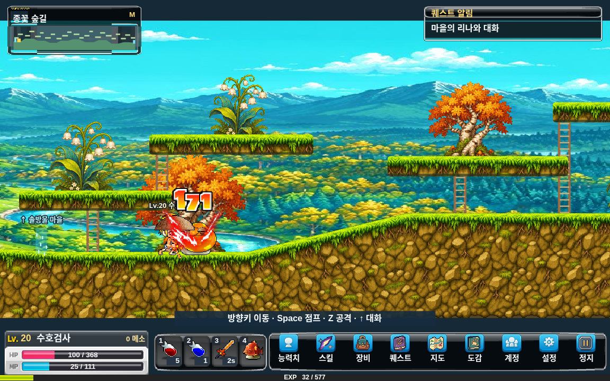

# Maplee

Maplee는 브라우저에서 플레이하는 개인용 픽셀 액션 RPG입니다. 솔방울 마을부터 노을알 분지까지 9개 지역을 탐험합니다. 지역 끝의 포털 앞에서 ↑를 누르면 다음 지역으로 이동합니다. 카메라는 이전 버전보다 가로와 세로로 25% 넓게 보이며 캐릭터의 이동과 등반을 따라갑니다.

[웹에서 플레이](https://maplee-pixel-world.jisung-20090725.chatgpt.site)



회원가입 후 계정마다 캐릭터를 최대 4명까지 만들 수 있습니다. 생성 화면에서 각 직업의 기본 외형을 미리 볼 수 있습니다. 이전에 같은 주소에서 플레이한 브라우저의 세이브는 빈 슬롯의 생성 화면에서 가져올 수 있습니다.

## 공용 월드

웹게임에서 각자 계정에 로그인한 뒤 캐릭터를 선택하면 공용 월드에 들어갑니다. 같은 지역에서 다른 플레이어의 이동, 장비, 공격 동작을 볼 수 있습니다. 포털로 다른 지역에 도착해도 공용 월드 연결은 이어집니다. 같은 몬스터를 공격하면 체력과 리스폰을 공유하고, 처치에 기여한 플레이어는 각자 경험치와 전리품을 받습니다. 계정 메뉴의 **혼자 하기**로 전환하거나 다시 접속할 수 있습니다.

기본 공격은 착용한 무기에 따라 검격, 화살, 마력탄으로 달라집니다. 검 기본 공격은 0.4초 동안 24장의 무기 도트를 재생하며 칼끝이 앞으로 뻗을 때 피해를 줍니다. 필드와 장비창에서 같은 캐릭터·장비 도트를 사용합니다. 걷기와 대기의 기본 재생 간격은 [클래식 캐릭터의 공개 동작 메타데이터](https://maplestory.io/api/wz/GMS/83/Character/00002000.img/walk1/0/delay)를 참고했습니다.

## 사냥과 성장

- 달바람 고원 동쪽에 잿등불 숲과 안개등 부두를 추가했습니다. 새 지역의 이끼 망령과 닻불 망령은 장비를 떨어뜨립니다.
- 장비는 17종에서 37종으로 늘었습니다. 새 장비는 마을·항구·고원 상점과 몬스터 사냥에서 획득합니다. 검과 단검, 활, 완드, 건틀릿은 큰 도트로 표시됩니다.
- 생성할 때 모험가 및 6개 직업 중 하나를 고릅니다. Lv. 5부터 마을의 전직 NPC를 통해 직업을 바꿀 수 있습니다. 직업에 맞지 않는 장비는 가방으로 돌아갑니다.
- 그림자 척후병의 쌍섬은 한 적을 두 번 찌릅니다. 파도 격투가는 회전하며 주변 적을 공격합니다. 새벽 치유사는 HP를 회복하고 언데드에게 피해를 줍니다. 각 직업의 보조 스킬은 Lv. 7부터 배울 수 있습니다.

9개 지역에 25개 사냥 지점이 있습니다. 종꽃 숲길은 가로 길이를 줄이고 두 그루의 나무를 따라 올라가는 수관길을 추가했습니다. 안개등 부두 동쪽의 바람뿌리 거목에서는 등불딱정벌레와 솜깃 방울새가, 노을알 분지에서는 스톤골렘과 솜깃 방울새, 정예 머쉬맘이 등장합니다. 몬스터는 지역별 웨이브로 다시 등장하며, 지도에서 권장 레벨을 확인할 수 있습니다.

[게임에서 열린 상태창 보기](docs/character-stat.webp)

## 실행

Python 3.10+와 Node.js 24+가 필요합니다. 아래 명령으로 브라우저 파일을 빌드하고 로컬 계정 서버를 엽니다.

```sh
python build.py
node server/local.mjs
```

브라우저에서 http://127.0.0.1:8000 을 엽니다. 로컬 서버는 계정과 월드 상태를 이 PC의 `.maplee-data`에 저장합니다. 배포에서는 Cloudflare Workers의 R2에 계정과 세이브를, D1에 접속과 공동 전투 상태를 저장합니다.

| 조작 | 키 |
| --- | --- |
| 이동 · 점프 | ← → · Space |
| 대화·포털·사다리 | ↑ · 사다리 내려가기는 ↓ |
| 발판 내려가기 | ↓ + Space |
| 기본 공격·주력 스킬·보조 스킬 | Z · X · V |
| 능력치·스킬·장비 | C · S · I |
| 퀘스트·지도·도감 | Q · M · B |
| 퀵슬롯·마을 귀환·저장 | 1~4 · R · K |

상태창과 장비창을 열어도 이동과 전투는 계속됩니다. 제목 표시줄을 끌어 창을 옮기고, 휠·터치·창 안의 화살표로 내용을 스크롤할 수 있습니다. 가방의 도트 아이콘을 누르면 장착 조건과 능력치가 표시됩니다. 일시정지 버튼으로만 멈출 수 있습니다. 게임 진행은 5초마다 계정의 선택된 슬롯에 자동저장됩니다. 포털 이동, 장비·진행 변경, 캐릭터 전환과 페이지 닫기 때도 저장을 요청합니다. K 키나 계정 창의 지금 저장 버튼을 사용할 수도 있습니다.

## 소스와 검사

- `maplee/engine.py`는 물리, 전투, 몬스터 AI, 진행을 담당합니다.
- `maplee/render.py`는 필드를, `maplee/windows.py`는 HUD와 게임 창을 별도 캔버스에 그립니다. `maplee/ui.py`에서 입력을 게임 동작에 연결합니다.
- `tools/draw_hero.py`는 재생성할 때만 공개 렌더러에 접속합니다. 이 파일을 실행한 뒤 `tools/draw_worn.py`를 실행하면 캐릭터와 장착 장비 시트를 재생성합니다. `tools/draw_townsfolk.py`와 `tools/draw_combat.py`는 마을 NPC와 전투 효과를 그립니다. 도트 생성 스크립트는 Pillow를 사용합니다.
- `tools/pack_open_art.py --help`에서 종꽃 숲길 배경의 재생성 입력을 확인할 수 있습니다.
- `python -m unittest discover -s tests`로 맵, 타격 타이밍, 보스 드롭, 제작, 세이브 호환성을 검사합니다.

- 빌드 후 `node --test tests/accounts.test.mjs`로 계정 격리, 슬롯·저장 충돌, 다른 플레이어 표시, 동시 타격과 처치 보상, 포털 이동을 검사합니다.

## 공개 에셋 출처

종꽃 숲길의 나무 레이어는 Luis Zuno의 [SunnyLand Tall Forest Environment](https://opengameart.org/content/sunnyland-tall-forest-environment) (CC0)를 사용했습니다.
