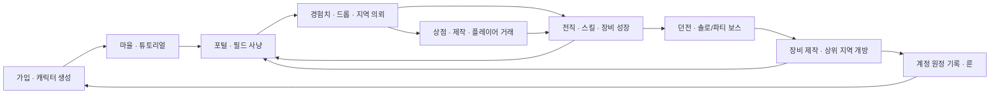

# Maplee 게임 시스템 설계

현재 Maplee에 전직, 사냥, 장비, 보스, 계정 성장과 거래를 연결하는 설계다. 기존 캐릭터 4슬롯, 포털 이동, 도트 UI, 캐릭터를 따라가는 카메라, 공용 월드와 혼자 하기를 출발점으로 삼는다. 아래 레벨, 확률, 입장 횟수, 성능 수치는 **Maplee의 첫 밸런스 가안**이다. 비교 자료의 패치 수치를 그대로 적용하는 방식은 쓰지 않는다.

## 구현된 기반

공개 버전은 캐릭터 ID, 장비 일련번호, 기존 4슬롯의 D1 이전, 서버 타격과 중복 방지 보상, 기존 상점·제작·스킬·의뢰 처리, 공용·개인 필드를 사용한다. 필드 전리품은 처치 시 가방에 자동 지급하며, 바닥 드롭의 개별 줍기는 후속 단계에 포함한다. 아래 현재 코드 표는 설계 작성 당시의 기준이다.

## 1. 전체 플레이 흐름

- **짧게 접속했을 때** 사냥터 두세 웨이브, 의뢰 하나 또는 던전 한 판을 끝내고, 다음 할 일이 지도나 퀘스트 안내에 남는다.
- **길게 플레이할 때** 장비 세트를 완성하고 보스 패턴을 익혀 다음 지역을 연다. 필드 사냥, 제작, 보스 중 두 경로 이상에서 다음 단계 장비를 얻을 수 있게 한다.
- **여럿이 접속했을 때** 같은 필드에서 편하게 합류한 뒤 파티 던전과 보스로 이동한다. 희귀 장비와 의뢰 진행은 기여한 캐릭터별로 지급한다.
- **새 캐릭터를 만들 때** 외형, 직업, 인벤토리, 퀘스트, 단축키를 따로 저장한다. 계정 도감 및 원정 기록은 공유한다.

## 2. 조사 결과와 현재 코드

| 참고한 시스템 | 확인한 내용 | Maplee 설계에 반영 |
| --- | --- | --- |
| 전직과 후반 스킬 | 전직이 스킬 슬롯과 후반 성장 재료의 획득처를 여는 구조. [V 매트릭스](https://maplestory.nexon.com/Guide/N23GameInformation/Articles/404) · [HEXA 매트릭스](https://maplestory.nexon.com/Guide/N23GameInformation/Articles/405) | 직업별 승급 기술과, 원하는 효과를 슬롯에 넣는 룬판을 도입 |
| 장비 | 기본 능력치, 강화, 추가 능력치, 잠재 옵션이 각기 장비 성장에 기여함. [장비 기본](https://maplestory.nexon.com/Guide/N23GameInformation/Articles/410) · [스타포스](https://gi.maplestory.nexon.com/Guide/GameInformation/ItemEnhancement/StarforceEnforcement) · [장비 전수](https://maplestory.nexon.com/Guide/N23GameInformation/Articles/414) | 재련, 옵션 각인, 재련 전승을 공방에서 단계적으로 제공 |
| 사냥과 보스 | 레벨에 따라 필드와 던전을 추천하고, 보스 보상과 주기 제한으로 다음 장비 획득을 유도함. [몬스터파크](https://maplestory.nexon.com/guide/n23gameinformation/articles/463) · [보스 보상](https://maplestory.nexon.com/guide/n23gameinformation/articles/458) · [Grandis Library 레벨 가이드](https://grandislibrary.com/content/level-content-guide) | 지역별 의뢰, 짧은 반복 던전과 주간 보스, 개인 보상 사용 |
| 계정 성장 | 다른 캐릭터 육성이 계정 효과와 연결됨. [유니온](https://maplestory.nexon.com/Guide/N23GameInformation/Articles/407) · [링크 스킬](https://gi.maplestory.nexon.com/Guide/GameInformation/Skill/LinkSkill_Info) | 4슬롯에 맞춰 원정 기록의 공용 혜택과 동료 특기 2칸 제공 |
| 거래 | 물품을 등록하고 검색해 구입하고 판매 대금을 받는 흐름. [메이플 옥션](https://gi.maplestory.nexon.com/Guide/GameInformation/ItemTrade/MapleAuction) | 등록 시 보관, 구매 시 잔액과 소유권을 한 번에 변경 |
| 공개 GitHub | 직업 JSON에 직업군, 주 능력치, 무기, 직업 효과가 있고 스킬도 별도 데이터에 담김. 사냥터 컴포넌트는 이름, 아이콘, 권장 레벨과 입장에 필요한 수치를 표시함. [직업 JSON](https://github.com/ikasuu/grandislibrary/blob/master/public/data/explorers/bowmaster.json) · [사냥터 코드](https://github.com/ikasuu/grandislibrary-next/blob/master/components/content/TrainingMap.js) | 직업과 사냥터를 코드 분기보다 데이터로 정의하고 필드·지도·UI에서 같은 데이터를 읽게 함 |

| 현재 Maplee에서 확인한 상태 | 설계에서 필요한 변경 |
| --- | --- |
| 자체 계정 4슬롯, 직업·성별·피부·머리 선택, 진행 자동저장과 저장 충돌 검사. [계정 서버](../server/accounts.mjs) · [로비](../maplee/lobby.py) | 캐릭터마다 고정 ID를 부여하고 슬롯 번호와 분리. 계정 창고, 우편, 원정 기록은 계정 ID에 연결 |
| 모험가와 6직업, AP/SP, 장비 6부위, 주력·보조 스킬, 가게와 제작. 장비 수량은 종류 ID로 저장. [콘텐츠](../maplee/content.py) · [게임 엔진](../maplee/engine.py) | 스킬을 개별 ID로 저장. 장비의 강화, 귀속, 소유권을 나타내는 개별 장비 ID 추가 |
| 11지역·30사냥지점, 포털, 사다리, 층별 몹과 웨이브 리스폰. [맵 데이터](../maplee/content.py) · [사냥터](../maplee/hunting.py) | 좌표 범위와 별도로 맵·포털·스폰의 영구 ID를 사용. 파티 인스턴스와 상위 지역을 같은 데이터 구조로 추가 |
| 공용 월드는 몬스터 HP·리스폰을 서버가 계산하고 약 320ms 간격으로 동기화. 브라우저가 타격 강도를 전송하고 처치 보상을 로컬 세이브에 반영. [공용 월드 서버](../server/world.mjs) · [클라이언트](../maplee/world.py) | 공유 전투의 피해량·드롭·XP·화폐를 서버에서 확정. 거래와 파티 보스에 앞서 재시도해도 보상이 한 번만 반영되도록 저장 구조 개선 |

## 3. 캐릭터와 성장

### 생성과 기본 순서

로그인 → 슬롯 선택 → 직업별 도트 미리보기 → 이름·성별·피부·머리 선택 → 마을에서 이동, 점프, 대화, 줍기, 첫 포털을 배운다. 생성 화면에서 직업을 바로 골라도 되고 모험가로 시작해 Lv.5에 고를 수도 있다. 미리보기, 필드, 장비창은 같은 외형 데이터와 도트 레이어를 사용한다. 무기는 손별 앵커를 사용해 착용과 공격 방향을 맞춘다.

| 레벨 | 열리는 콘텐츠 | 보상과 다음 목표 |
| --- | --- | --- |
| 1~4 | 솔방울 마을, 튜토리얼과 첫 의뢰 | 기본 장비, 물약, 단축키 |
| 5~11 | 1차 직업, 항구·광산까지의 지역 의뢰 | 직업 무기, 주력·보조 기술, 제작 입문 |
| 12~24 | 기존 중·후반 사냥터, 첫 던전과 연습 보스 | 세트 장비, 재련 재료, 승급 퀘스트 |
| 25~39 | 직업 전문화, 두 상위 지역과 파티 보스 | 역할 기술, 두 번째 세트, 공방 전승 |
| 40~60 | 룬판, 상급 지역, 주간 보스와 원정 기록 | 선택형 기술 강화, 고급 제작, 계정 공용 보상 |

기존 캐릭터의 레벨과 진행을 보존한다. 신규 사냥 보상과 레벨 테이블은 Lv.60까지 우선 제작하고, 기존 데이터에 저장된 그 이상의 레벨은 유지한다. 승급·보스 해금은 조건을 별도로 판정한다. AP는 현재의 힘·체력·정신·민첩을 사용하고 각 배분에 따른 실제 공격력·HP·MP·속도 변화를 미리 표시한다. SP는 기술별 최대 랭크와 선행 조건을 가진다. 전직을 바꾸면 배운 기술과 프리셋은 직업별로 보관하고, 조건을 잃은 착용품은 가방 또는 수령함으로 보낸다.

### 직업과 스킬

| 직업 | 초반 전투 | 전문화에서 고르는 방향 |
| --- | --- | --- |
| 모험가 | 기본 무기와 별빛 파동으로 조작 연습 | 여섯 직업 중 선택 |
| 수호검사 | 근거리 부채꼴 베기, 가시 방벽 | 범위 검격 또는 방패로 피해 완화 |
| 숲길잡이 | 원거리 화살, 바람걸음 | 정밀 사격 또는 관통 화살 |
| 별빛술사 | 착탄 지점 범위 공격, 마력 장막 | 설치 장판 또는 순간 집중 공격 |
| 그림자 척후병 | 두 번 찌르기, 연막 | 후방 연계 또는 기동성 |
| 파도 격투가 | 회전 타격, 물결 질주 | 추격 연타 또는 주변 넉백 |
| 새벽 치유사 | 회복과 마법 공격, 새벽의 축복 | 파티 보호 또는 광역 공격 |

직업마다 기본 공격, 사냥용 기술, 보스용 기술, 이동·생존 기술을 갖춘다. 지원 직업도 혼자서 의뢰와 보스를 완주할 수 있다. Lv.40 룬판은 2칸으로 시작한다. 같은 기술에 붙이는 변형은 하나만 활성화한다. 예를 들어 폭뢰 화살의 관통 범위를 넓히는 룬과 첫 적에 맞을 때 폭발하는 룬은 같은 기술의 대안이다. 룬은 던전·보스·필드 재료로 제작하고 중복 룬은 분해해 제작 재료로 돌려받는다.

## 4. 전투, 맵, 사냥

### 타격과 애니메이션

1. 입력 시 재사용 대기시간, MP, 장착 무기, 행동 상태를 확인한다.
2. 공격은 준비, 타격, 회복 구간을 갖는다. 검은 칼 끝이 닿는 프레임에, 투사체는 대상과 겹치는 프레임에 판정한다. 다단기는 각 타격 번호별로 한 대상에 한 번 적용한다.
3. 공격 상자와 몬스터 피격 상자는 외형과 별도 데이터로 둔다. 공격 방향, 상대 높이, 사거리, 스킬의 최대 대상 수를 검사한다. 타깃이 없으면 준비 동작은 재생되고 피해는 발생하지 않는다.
4. 결과 이벤트에 피해량, 치명타, 방향, 타격 위치를 넣는다. 클라이언트가 그 위치에 타격 이펙트, 숫자, 효과음을 재생한다. 공용 월드에서는 서버가 확정한 피해 표시와 몬스터 HP를 사용한다.

피해 공식의 첫 버전은 `max(1, floor((공격력 × 스킬 계수 − 방어) × 치명타 배율 × 대상 보정))`으로 정의한다. 직업 균형이 확인된 뒤 방어 무시와 보스 추가 피해를 별도 스탯으로 연다. 사냥 기준은 동레벨 일반 몬스터 2~4회 공격과 정예 20~40초를 목표로 둔다. 캐릭터와 몬스터의 대기·이동·공격·피격·사망은 서로 전환할 수 있고, 캔버스에서 최근접 확대를 사용한다. 프레임의 표시 시간과 피해 발생 시점은 각각 검증한다.

### 월드와 스폰

- 지역 하나는 이어진 지면, 층별 발판, 사다리, 장식, 하늘·중경 배경으로 이루어진다. 배경은 고유 크기로 반복하고 카메라에 따라 층별 속도로 스크롤한다. 포털→반대편 도착 지점의 관계를 맵 데이터로 정의하고 ↑ 또는 대응 터치로 이동한다.
- 맵의 도착 지점과 NPC 주변을 안전 구역으로 지정한다. 사냥터마다 몬스터 종류·상한·재등장 주기·권장 레벨·보상을 정의한다. 지면과 각 층을 순회하는 경로를 점프로 검사하고 층간 이동은 사다리와 하강 동작으로 테스트한다.
- 일반 몹은 순찰 → 감지 → 추적 → 공격 예고 → 타격 → 복귀로 움직인다. 공중 몹은 기준 높이와 이동 범위를 별도로 갖고 발판과 카메라를 기준으로 공중 위치를 표시한다. 정예는 별도의 출현 주기와 패턴을 사용한다.
- 사망하면 가까운 마을이나 체크포인트에서 부활한다. 인스턴스에서는 제한 시간, 남은 부활 횟수, 재접속 유예를 보여 준다. 경험치 또는 장비 손실은 첫 밸런스 범위에서 적용하지 않는다.

### 경험치·아이템 드롭·의뢰

- 유효 타격 또는 게임이 인정한 파티 지원으로 처치에 기여하면 경험치·골드·드롭을 캐릭터별로 생성한다. 일회성 이벤트 ID는 `인스턴스 또는 채널 + 스폰 ID + 생명 번호 + 수령 캐릭터 ID`로 구성한다. 경험치 지급은 처치 직후, 아이템은 필드 줍기 또는 수령함으로 가져간다.
- 드롭 테이블은 기본 재료, 낮은 확률의 장비, 보스 제작 재료로 구성한다. 드롭 권한과 만료 시간은 서버가 기록한다. 가방이 가득 차면 보스·퀘스트 장비는 수령함으로 보내고, 일반 전리품은 줍기 제한과 남은 시간을 표시한다.
- 퀘스트는 잠김 → 수락 가능 → 진행 → 보상 가능 → 수령 완료로 상태를 가진다. 조건은 대화, 특정 몹 처치, 특정 아이템 보유, 탐험, 제작, 보스 클리어로 조합한다. 진척은 서버 처치·획득 이벤트로 갱신하고 수령 단계에서 재료 소모와 보상을 한 번에 반영한다.
- 도감은 발견 → 첫 처치 → 연구 완료로 갱신한다. 이미지, 지역, 레벨, 공개 드롭을 표시하며 희귀 장비를 먹기 위한 의무 조건으로 사용하지 않는다.

예를 들어 Lv.18 수호검사는 노을알 분지 동쪽 포털에서 구리층 계단에 간다. 첫 의뢰가 버블링 처치와 재료 수집을 안내하고, 상층 사다리 근처의 스톤골렘이 지역 장비의 두 번째 획득처가 된다. 모은 재료로 공방에서 첫 재련을 할 수 있다. Lv.20에는 같은 지역 지도에서 파수꾼 입구를 찾고, 보스 보상이나 추가 사냥 중 먼저 갖춘 장비로 물빛 씨앗숲에 도전한다.

## 5. 장비·경제·거래

| 시스템 | 동작 |
| --- | --- |
| 인벤토리와 장비 | 장비, 소비, 재료, 퀘스트 탭. 소비·재료는 수량을 묶고 강화 가능한 장비는 개별 ID로 저장. 기존 6부위에 장갑·신발·망토·보조장비를 확장. 양손 무기는 보조 무기와의 장착 조건을 명시 |
| 획득과 제작 | 일반 세트는 필드 드롭 및 마을 판매, 지역 세트는 제작 및 정예 드롭, 상위 장비는 보스 드롭 및 보스 재료 누적 제작. 제작 전에 결과와 소비량 표시 |
| 강화 | 재련은 골드와 재료 사용. 가안은 +1~+3 성공 100%, +4~+6은 각각 80%, 65%, 50%. 실패 시 해당 단계 유지, 같은 단계 3회 연속 실패 후 다음 시도 확정. 주문서 역할은 특정 능력치 1종을 고르는 각인이 담당 |
| 옵션과 전승 | 희귀 이상에 옵션 1~3줄. 옵션을 바꾸기 전에 새 결과와 기존 결과를 비교, 선택할 때에만 적용. 전승은 같은 장비 부위·강화 계열끼리 가능하며 출발·도착 장비와 옮길 강화 수준을 확인 화면에 표시 |
| 착용 외형 | 머리·몸·신발·등·무기 레이어. 발판에 닿는 캐릭터 좌표는 외형이나 무기 크기에 영향받지 않음. 코디 장비는 전투 능력치와 별도 프리셋 |
| 상점과 재화 | 골드는 필드·의뢰·보스·NPC 판매에서 유입되고 물약·이동·제작·강화·거래 수수료로 소모. 골드 수급과 소모를 매주 집계. 원정·보스 전용 토큰은 지정 교환처에서만 사용 |
| 계정 창고 | 공유 허용 재화와 장비만 입고. 캐릭터 귀속·계정 귀속·교환 가능 상태를 아이콘과 문구로 표시. 수령함에는 수령 가능 기간과 발급 이유를 남김 |
| 거래소 | 교환 가능 장비·재료만 등록. 판매 등록 시 서버 보관, 구매 요청이 확정되면 구매자 차감·판매자 대금·아이템 이전을 한 트랜잭션으로 적용. 최초 가안 48시간, 판매 수수료 5%. 취소·만료 때 보관한 물건을 돌려줌 |

같은 상점 구매, 등록 또는 구매 요청은 동일 작업 ID로 다시 보내도 가격 차감과 아이템 이전이 각각 한 번만 일어난다. 가방에 반환할 공간이 없으면 수령함을 사용한다. 마켓 판매량이 적은 초기에는 NPC·제작·보스 루트만으로 성장할 수 있게 한다.

채집은 안전한 지역 자원과 사냥 구역의 희귀 자원으로 나눈다. 공방의 첫 제작 탭은 물약·일반 장비·강화 재료이며 각 레시피에서 필요한 획득처를 열어 볼 수 있다. 전문 제작은 계정 원정 기록에 남기고, 필수 스토리 장비에는 별도 제작 숙련도가 필요하지 않게 한다.

## 6. 파티, 보스, 일일·주간 콘텐츠

- 파티는 최대 4명, 초대·수락·탈퇴·리더 이전을 지원한다. 멤버 패널에 위치, HP, 접속 상태를 표시한다. 필드의 몹 HP는 같은 채널에서 공유하고, 파티 보스의 몹은 일행 전용 인스턴스에 둔다.
- 보스 입장 전 권장 레벨, 전투 준비 조건, 난이도, 남은 보상 횟수를 알려 준다. 연습 모드는 패턴과 시간 제한을 유지하고 장비 보상은 미리 비활성화한다. 보스는 솔로 및 2~4인으로 열고 인원에 따라 HP와 보상 조건을 조정한다. 필수 패턴은 참가 인원수와 무관하게 수행 가능해야 한다.
- 첫 보스 **구리봉인 파수꾼**. 1페이즈는 바닥 표시 뒤 돌진, 70% 이하에서는 위쪽 발판에 보호 장치를 소환한다. 35% 이하에서는 사다리 접근과 안전 발판 변경을 조합한다. 성공하면 개인 장비 보상 상자와 교환 재료를 지급한다. 중간 이탈 뒤 유예 내 재접속하면 살아 있는 같은 인스턴스에 복귀한다.
- **일일 의뢰**는 같은 레벨의 사냥·채집·짧은 던전 중 고른다. **주간 기록**은 보스 및 고급 제작의 교환 재료를 준다. 첫 가안은 일일 05:00, 주간 목요일 05:00 한국 시간이다. 서버가 기간 ID를 만들고 화면에는 남은 시간과 해당 기간 수령 상태를 표시한다.
- **원정 기록**은 첫 캐릭터 Lv.25부터 계정 도감·코디·창고의 목표를 연다. 육성한 직업이 계정에 동료 특기를 제공하고 캐릭터마다 최대 2개를 장착한다. 직업 중복 및 공용 보너스에 상한을 둔다. 한 캐릭터만으로도 모든 필수 보스에 진입할 수 있게 밸런스를 맞춘다.
- 길드, 친구, 지역 채팅과 파티 모집은 역할 권한과 차단·신고를 포함해 추가한다. 길드 보상은 첫 버전에서 길드 단위 꾸미기와 공동 도전 기록으로 제공한다. 계절 이벤트는 일정·미션·교환소를 데이터로 정의하고, 종료 후 남은 토큰 교환 기간을 표시한다. 업적, 칭호, 코디, 펫은 전투 이후에 붙이는 수집 콘텐츠로 운용한다.

## 7. 클라이언트와 서버 설계

### 데이터 모델

| 데이터 | 주요 필드 및 무결성 조건 |
| --- | --- |
| 캐릭터 | `character_id, account_id, slot, job_id, level, xp, map_id, checkpoint_id, revision`. 계정 내 슬롯 0~3 유일. 슬롯을 재사용해도 캐릭터 ID는 새로 발급 |
| 스킬·장비 | `learned_skill(character_id, skill_id, rank)`, `item_instance(id, template_id, owner, bind, refinement, affixes, version)`. 장착에는 소유·레벨·직업·부위가 일치해야 함 |
| 맵·몬스터 정의 | `map_id, zone_id, bounds, background_layers, surfaces, portals`, `spawn_id, species_id, surface_id, home, wave, loot_table_id`. 배열 순서와 독립적인 ID를 사용 |
| 전투와 보상 | `instance_id, encounter_id, spawn_id, life, hp, respawn_at`, `reward_id, character_id, source, payload, status`. 같은 전투·보스 주기에서 수령권은 한 캐릭터에 한 번만 생성 |
| 퀘스트·원정·인스턴스 | 캐릭터별 퀘스트 상태·목표별 진척, 계정별 원정 보상, 파티별 입장·클리어 내역과 일일·주간 기간 ID |
| 경제 | 잔액, 변경 원장, 거래 등록, 보관함, 지급 작업을 함께 기록. 원장에는 이유·원천 ID·변동량·작업 ID를 남기고, 작업 ID는 캐릭터 내 유일 |

정적 콘텐츠에는 장비·종족·퀘스트·맵 ID를 검증하는 빌드 단계를 둔다. 클라이언트와 서버는 같은 카탈로그와 `content_version`을 사용한다. 맵 배치 버전은 별도 관리하고, 삭제·교체된 맵에 있던 캐릭터는 기록된 체크포인트 또는 연결 포털에 배치한다. 몬스터나 의뢰를 이동해도 도감 기록과 완료 기록이 따라가도록 기존 숫자 ID에서 영구 ID로 매핑한다.

### 시스템 경계와 상태 변경

- **브라우저**. 기존 Python 게임 로직과 캔버스 렌더링은 조작, 예측 이동, 애니메이션, HUD를 담당한다. 저속 기기에서도 입력을 즉시 표시하고, 원격 캐릭터는 서버 스냅샷 사이를 보간한다.
- **Cloudflare Worker와 저장소**. 기존 자체 로그인·세션과 R2 세이브를 유지하면서 D1에 서버가 확정한 진행·경제를 단계적으로 저장한다. 공용 전투에서 클라이언트는 `skill_id, tick, 방향, input_sequence`로 행동을 요청한다. 서버는 세션과 캐릭터, 최신 맵·위치, 장비와 스킬, 재사용 시간 및 타격 범위를 확인한 뒤 피해량을 계산한다.
- **일관성**. 보상 확정과 경제 상태 변경은 D1의 제약 및 동일 원자적 배치 안에서 처리한다. 선행 조건을 만족한 갱신의 식별자를 후속 원장·보관함 작업이 확인하게 한다. 재전송 시 이미 기록된 결과를 돌려준다. 이전 320ms 동기화로 필드 규모를 먼저 검증하고, 보스처럼 짧은 반응 시간이 필요한 인스턴스는 별도 서버 틱과 WebSocket을 검토한다.
- **API 전환**. 기존 `/api/session`, `/api/slot/:slot`, `/api/world/join|sync|leave`는 마이그레이션 기간 동안 함께 쓴다. 신규 진행 API는 `character_id`와 서버 리비전을 기준으로 커맨드를 받는다. 자동저장은 설정과 최근 체크포인트를 기록하고, XP·골드·장비는 게임 커맨드에서 즉시 확정한다.
- **혼자 하기 및 세이브 이전**. 처음 서버 확정 경제가 열리기 전 기존 슬롯을 한 번 읽고 매핑 결과와 수량을 검증한다. 기존 장비·레벨과 진행은 보존하되, 검증된 공용 경제가 시작되기 이전의 자산은 교환 조건을 명시해 이전한다. 온라인 솔로 인스턴스는 서버 보상을 받는다. 연결 없이 플레이하는 모드는 별도 연습 세이브에 저장하며 공용 화폐·장비를 덮어쓰지 않는다.

첫 서버 진행 테스트에는 이동 입력과 분리된 `equip_item`, `pick_up_drop`, `claim_quest`, `refine_item` 커맨드를 사용한다. 각 커맨드는 대상 ID와 예상 리비전을 받고 변경된 상태와 새 리비전을 반환한다. 이미 확정된 작업 ID는 이전 결과를 그대로 반환하고, 다른 작업이 먼저 반영됐다면 최신 상태를 받아 비교할 수 있게 충돌을 반환한다.

### 도트 UI와 성능

필드와 HUD를 지금처럼 별도 캔버스에 그린다. 장비·아이템·퀘스트 창이 열려도 게임은 계속 진행한다. 키보드와 터치에서 창을 이동·스크롤할 수 있게 하고, 좁은 화면에서는 최근 창을 앞에 두되 주 조작 버튼에 겹치지 않게 배치한다. 지도는 권장 레벨, 도착 포털, 다음 사냥터를 표시한다. 장비 툴팁은 현재 장비 대비 공격력, HP, 귀속과 강화 조건만 먼저 보여 준다.

정적 지형을 맵 조각별로 캐시하고 보이는 부분만 그린다. 몬스터·투사체·이펙트는 카메라와 사냥 구역 밖에서 렌더링하지 않으며 전투 결과와 별도로 화면 이펙트 개수를 제한한다. 화면 한 장의 중앙 프레임 시간은 데스크톱 16.7ms 이하, 기준 모바일은 33ms 이하를 초기 목표로 삼는다. 측정은 플레이어 4명과 몬스터 20마리가 보이는 전투에서 하고 실제 기기, 브라우저, 네트워크를 기록한다.

## 8. 구현 순서와 완료 기준

| 순서 | 작업 | 완료를 판단하는 게임 시나리오 |
| --- | --- | --- |
| 1. 기반 정리 | 카탈로그 고정 ID, 기존 세이브 매핑, 캐릭터·장비 ID, 원장, 서버 성장과 보상 | 기존 4슬롯을 이전한 뒤 이름·외형·퀘스트·착용을 확인. 같은 처치·수령 요청을 재전송해도 XP와 장비가 한 번만 들어옴 |
| 2. 사냥과 직업 | 튜토리얼, 직업별 스킬 데이터, 전직, 드롭 줍기, 인벤토리 비교, 사냥터 안내 | 새 캐릭터로 시작해 포털을 타고 사냥한 뒤 드롭으로 얻은 무기를 장착. 외형과 공격 판정이 바뀌고 재접속 뒤 유지 |
| 3. 공방과 파티 | 강화·옵션·전승, 파티 초대, 던전·첫 보스, 개인 보상 | 서로 다른 두 계정이 파티 보스를 잡음. 각자의 보상과 입장 기록이 맞고, 재접속이나 네트워크 재시도로 중복 지급되지 않음 |
| 4. 계정 성장과 후반 | 전문화, 룬판, 일일·주간, 원정 기록, 장비·지역 확장 | 첫 캐릭터가 상위 맵을 열고 두 번째 캐릭터가 동료 특기를 받음. 혼자 하는 캐릭터도 필수 보스와 장비 제작을 완료 |
| 5. 거래와 커뮤니티 | 계정 창고, 수령함, 거래소, 친구·길드·채팅, 이벤트 | 두 구매자가 같은 매물을 동시에 사도 한 명만 아이템을 받고 한 번만 차감. 취소·만료·가방 초과 때 소유권을 추적할 수 있음 |

기존 Python 테스트의 맵·발판·타격 타이밍·장비 호환성 검사를 계속 사용한다. Node 테스트에 보상 재시도와 동시 소유권 처리, 기간 리셋, 서로 다른 슬롯의 충돌 방지를 추가한다. 매 단계에서 실제 모바일 터치로 로그인 → 캐릭터 선택 → 포털 → 사냥 → 장비 장착 → 재접속을 확인한다. 런타임에서는 레벨별 체류 시간, 몹 리스폰 시간, 골드 유입·소모, 보스 입장 대비 클리어, 프레임 시간을 수집해 위 가안을 조정한다.
